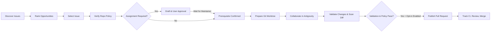

# Issue-to-PR Platform for Google Antigravity

[](https://www.postgresql.org/)
[](https://fastapi.tiangolo.com/)
[](https://react.dev/)
[](https://www.typescriptlang.org/)
[](https://tailwindcss.com/)
[](https://deepmind.google/)

A personal developer productivity platform that discovers open, unassigned public GitHub issues, evaluates them transparently using explainable ranking and repository contribution policies, prepares isolated local Git worktrees for collaborative coding in **Google Antigravity's standalone desktop app**, validates changes through diff security checks and automated tests, and conditionally publishes pull requests without unreviewed automation.

---

## 1. End-to-End Workflow



---

## 2. Core Pillars & Guardrails

1. **Broad Discovery without Hidden Results**:
   - Searches globally across public repositories using GitHub APIs.
   - Paginates, partitions queries, and deduplicates via PostgreSQL constraints.
   - All eligible issues remain accessible regardless of score. AI scores are purely advisory.
2. **Transparent, Explainable Ranking**:
   - Scores issues (0–100) based on your configured skills toolbox (Python, TypeScript, FastAPI, React, Docker, SQL, etc.), problem statement clarity, repository health, and estimated implementation effort.
   - Provides clear justification bullet points for every calculation.
3. **Repository Policy Preflight**:
   - Inspects `CONTRIBUTING.md`, `README.md`, issue templates, and maintainer instructions.
   - Classifies state: `READY_TO_WORK`, `ASSIGNMENT_REQUEST_REQUIRED`, `WAITING_FOR_MAINTAINER`, `POLICY_REVIEW_REQUIRED`, `BLOCKED`.
   - Never posts comments or claims issues without explicit user review and confirmation.
4. **Isolated Antigravity Workspace Integration**:
   - Safe cloning and cache management under `~/.issue_to_pr/cache/repos/`.
   - Dedicated Git worktrees under `~/.issue_to_pr/workspaces/task-<id>/<repo>/`.
   - New branch created following conventions: `fix/issue-<number>-<slug>`.
   - Automatically generates `.antigravity/BRIEF.md` and copyable implementation prompt.
   - Desktop handoff adapter invokes `/Applications/Antigravity.app` or `agy` CLI on macOS, with seamless copy-paste fallback.
5. **Validation & Git Diff Security Gate**:
   - Static diff scanner blocks commits containing AWS keys, RSA private keys, GitHub tokens, JWTs, `.env` files, or binaries.
   - Sandboxed test execution runner logs exact commands, stdout/stderr, and exit codes.
   - Strictly prohibits describing skipped or unrun tests as passed.
6. **Automated PR Publishing within Guardrails**:
   - Direct push if upstream permissions exist; automated fork-and-branch if push access is missing.
   - Creates pull request referencing issue (`Fixes #...`).
   - Automatically publishes PR only if auto-publish is explicitly opted into in Settings and all validation gates pass.
   - **Absolute Rule**: Never auto-merges pull requests or deploys software.

---

## 3. Engineering Documentation

Full architectural specifications and contracts are located in the [`docs/`](./docs) directory:

- [Architecture & Threat Model](./docs/ARCHITECTURE_AND_THREAT_MODEL.md)
- [Database Schema & Migrations](./docs/DATABASE_SCHEMA.md)
- [API Contracts & Typed Data Models](./docs/API_CONTRACTS.md)
- [Workflow State Transitions](./docs/WORKFLOW_TRANSITIONS.md)
- [GitHub Permission Model](./docs/GITHUB_PERMISSIONS.md)
- [Antigravity Desktop Handoff Design](./docs/ANTIGRAVITY_HANDOFF_DESIGN.md)
- [Test Plan & Acceptance Criteria](./docs/TEST_PLAN_AND_ACCEPTANCE_CRITERIA.md)

---

## 4. Quickstart Guide

### Prerequisites
- macOS (or Linux)
- Python 3.11+ (with `uv` package manager)
- Node.js 18+ and `npm`
- PostgreSQL 14+ (e.g. `brew install postgresql@16`)
- Google Antigravity standalone desktop app or `agy` CLI (installed on macOS)

### 1. Launch the Platform (Single Command)
Run the startup script from the project root:

```bash
cd /Users/shahi/Desktop/PROJECT/issue-to-pr-platform
./start.sh
```

This script:
1. Verifies and starts PostgreSQL service (`postgresql@16`).
2. Creates the `issuetopr` database if not present.
3. Launches the FastAPI backend at `http://127.0.0.1:8000`.
4. Launches the React Vite frontend at `http://127.0.0.1:5173`.

### 2. Access the Application
- **Interactive Dashboard**: [http://127.0.0.1:5173](http://127.0.0.1:5173)
- **Interactive API Documentation (Swagger)**: [http://127.0.0.1:8000/docs](http://127.0.0.1:8000/docs)
- **Health Check**: [http://127.0.0.1:8000/api/health](http://127.0.0.1:8000/api/health)

---

## 5. Running Tests

Run the complete backend test suite:

```bash
cd /Users/shahi/Desktop/PROJECT/issue-to-pr-platform
PYTHONPATH=backend ./backend/.venv/bin/pytest tests -v
```

All 15 unit and integration tests verify:
- **Phase 1**: Explainable ranking calculations, toolbox skill matching, blocker labels, and discoverability without hidden results.
- **Phase 2**: Policy inspector classification (`READY_TO_WORK`, `ASSIGNMENT_REQUEST_REQUIRED`, `BLOCKED`, `POLICY_REVIEW_REQUIRED`) and draft request approvals.
- **Phase 3**: Git diff secret scanner detecting RSA keys, GitHub PATs, AWS keys, JWTs, and prohibited `.env` files.
- **Phase 4**: PR publisher with upstream permissions check, fork workflows, and automatic PR publication upon opt-in.
- **Phase 5**: Startup reconciliation recovering interrupted tasks, duplicate PR detection blocking redundant pull requests, CI check run evaluation, maintainer review feedback parsing, and transitioning tasks back to `COLLABORATIVE_WORK` when changes are requested.
- **Background Worker**: Async background service managing scheduled discovery and persistent PR tracking loops.

---

## 6. Directory Structure

```
issue-to-pr-platform/
├── backend/
│   ├── app/
│   │   ├── api/v1/          # Endpoints: issues, tasks, discovery, settings, audit
│   │   ├── core/            # Configuration & directory defaults
│   │   ├── db/              # Async PostgreSQL engine & session factory
│   │   ├── models/          # SQLAlchemy relational models
│   │   ├── schemas/         # Pydantic validation & serialization models
│   │   ├── services/        # GitHub client, discovery, ranking, policy, worktree, validation, publisher
│   │   └── main.py          # FastAPI application & startup seed
│   └── .venv/               # Virtual environment managed with uv
├── frontend/
│   ├── src/
│   │   ├── components/      # Header, IssueInbox, Details, Pipeline, Queue, Workspace, Validation, PRs
│   │   ├── api.ts           # Typed API client
│   │   ├── types.ts         # TypeScript domain interfaces
│   │   ├── index.css        # Tailwind styling & glassmorphism
│   │   └── App.tsx          # Main dashboard coordinator
│   ├── tailwind.config.js
│   └── vite.config.ts
├── docs/                    # Architecture, Threat Model, Schema, API contracts, Permissions
├── tests/                   # Pytest test suite
├── start.sh                 # Single-command launcher
└── README.md                # Platform documentation
```
