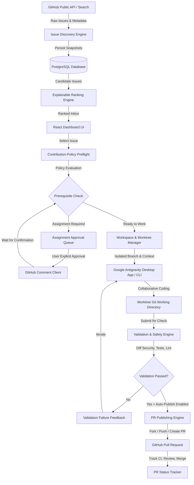

# Issue-to-PR Platform: Architecture and Threat Model

## 1. System Overview

The Issue-to-PR Platform is a personal developer productivity tool built to discover open, unassigned GitHub issues, evaluate them against explainable scoring and repository contribution policies, prepare isolated local workspaces for collaborative coding in Google Antigravity, validate changes with strict safety gates, and conditionally publish pull requests without unreviewed automation.

## 2. Component Architecture

### Backend Services (Python / FastAPI / SQLAlchemy / Pydantic)
1. **GitHub API Client (`app.services.github_client`)**:
   - Manages authenticated & unauthenticated rate limits with exponential backoff and secondary throttle handling.
   - Distinct operations: Public Discovery (read-only), Repo Policy Inspection (read-only), Assignment Comments (write, gated by user consent), Fork/Push/PR (write, gated by validation & auto-publish policy).
2. **Issue Discovery Engine (`app.services.discovery_service`)**:
   - Queries open, unassigned, non-PR issues from active public non-archived repositories.
   - Paginates, partitions queries (e.g. by created/updated date ranges, language), deduplicates via unique constraint `(repository_owner, repository_name, issue_number)`.
   - Records discovery checkpoints, sync coverage stats, and handles incremental refresh.
3. **Ranking & Skill Matching Engine (`app.services.ranking_service`)**:
   - Evaluates issues against a configurable skills profile (Python, TypeScript, React, FastAPI, Docker, etc.).
   - Transparent scoring breakdown: language match, description clarity, estimated effort, test coverage presence, learning value, and blocker detection.
   - All eligible issues remain visible; ranking is purely advisory.
4. **Contribution-Policy Inspector (`app.services.policy_inspector`)**:
   - Inspects `CONTRIBUTING.md`, `README.md`, issue templates, labels (e.g. `help wanted`, `good first issue`), and maintainer comments.
   - Categorizes state: `READY_TO_WORK`, `ASSIGNMENT_REQUEST_REQUIRED`, `WAITING_FOR_MAINTAINER`, `POLICY_REVIEW_REQUIRED`, `BLOCKED`.
5. **Workspace & Worktree Manager (`app.services.workspace_manager`)**:
   - Clones bare/mirror repo cache safely under `~/.issue_to_pr/cache/repos/`.
   - Creates dedicated Git worktrees under `~/.issue_to_pr/workspaces/<task_id>/`.
   - Creates clean task branches (e.g., `fix/issue-<number>-<slug>`).
   - Generates `.antigravity/BRIEF.md` with issue description, acceptance criteria, setup commands, and test conventions.
6. **Antigravity Desktop Handoff (`app.services.antigravity_handoff`)**:
   - Detects `/Applications/Antigravity.app`, `/Applications/Antigravity IDE.app`, and `agy` CLI on macOS.
   - Executes desktop launch (`open -a "Antigravity" <worktree_path>` or CLI) with robust error trapping.
   - Fallback provides full copyable prompt context and directory path in UI.
7. **Validation & Security Scanner (`app.services.validation_service`)**:
   - Static diff analysis: blocks commits containing high-entropy secrets, private keys, `.env` files, credentials, or binaries.
   - Sandboxed test execution: executes repo test commands with strict timeouts, capturing stdout/stderr and exit codes.
   - Disallows reporting skipped tests as passed.
8. **Automated PR Publisher (`app.services.pr_publisher`)**:
   - Pre-check gates: Auto-publish setting enabled + Task in `READY_TO_PUBLISH` + Validation passed + Assignment confirmed + No duplicate PR.
   - Handles upstream direct push (if write access) or fork-and-branch (creates/reuses fork, pushes to fork remote, opens PR to upstream base branch).
   - Never auto-merges or deploys.

---

## 3. Threat Model (STRIDE Framework)

### A. Spoofing & Authentication
- **Threat**: Forged requests or leaked GitHub Personal Access Tokens (PAT).
- **Mitigation**:
  - Tokens stored securely in database/environment, never exposed in frontend API responses or client logs.
  - Distinct token roles: read-only discovery vs write-capable operations.
  - In-memory token encryption / masking.

### B. Tampering
- **Threat**: Malicious repository content (e.g., injected scripts in issue body or PR templates) attempting to execute arbitrary code or corrupt local files.
- **Mitigation**:
  - All issue text, comments, and repository files treated as untrusted data.
  - No shell interpolation of issue titles or author inputs.
  - Worktree paths validated to remain strictly within designated workspace roots (preventing directory traversal `../`).

### C. Repudiation
- **Threat**: Unintended PR creations or assignment comments without auditability.
- **Mitigation**:
  - Persistent PostgreSQL audit event log (`audit_logs`) recording timestamp, actor, action, payload summary, and status.
  - Assignment comments require an interactive user confirmation modal before submission.

### D. Information Disclosure
- **Threat**: Leaking developer credentials, local SSH keys, or environment files into open-source pull requests.
- **Mitigation**:
  - Pre-publication Git diff scanner detects secrets (`BEGIN RSA PRIVATE KEY`, API keys, `.env`, AWS tokens).
  - Worktree excludes user's global credentials or parent workspace files.

### E. Denial of Service / Resource Exhaustion
- **Threat**: GitHub secondary rate limits, unbounded cloning of massive repos, or infinite test loops.
- **Mitigation**:
  - GitHub client implements automatic rate limit tracking, backoff headers (`Retry-After`, `x-ratelimit-reset`).
  - Shallow clones (`--depth 50`) and Git worktree isolation.
  - Test command runner enforces configurable per-command execution timeouts (default 120s) and memory caps.

### F. Elevation of Privilege
- **Threat**: Code execution escaping the isolated worktree to alter user host system or deploy software.
- **Mitigation**:
  - Commands executed strictly with CWD restricted to the specific worktree.
  - Hard constraint: No automated merge, release, or deployment commands exist in the application codebase.
