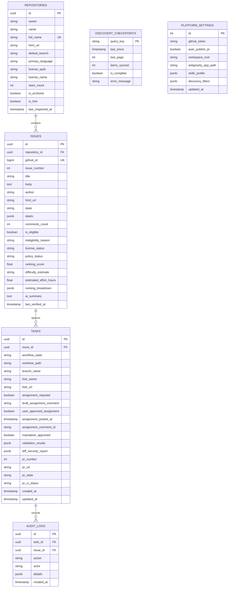

# Issue-to-PR Platform: Database Schema and Migration Design

## 1. Schema Diagram

## 2. Constraints and Invariants
1. **Uniqueness**:
   - `repositories(full_name)` must be unique (`owner/name`).
   - `issues(repository_id, issue_number)` has a composite unique constraint to prevent duplicates.
   - `tasks(issue_id)` enforces a single active task per issue.
2. **Referential Integrity**:
   - Cascading deletes on non-critical metadata, strict restrict on active tasks with open worktrees.
3. **Audit Immutability**:
   - `audit_logs` records are append-only. No updates or deletions are permitted through application APIs.
