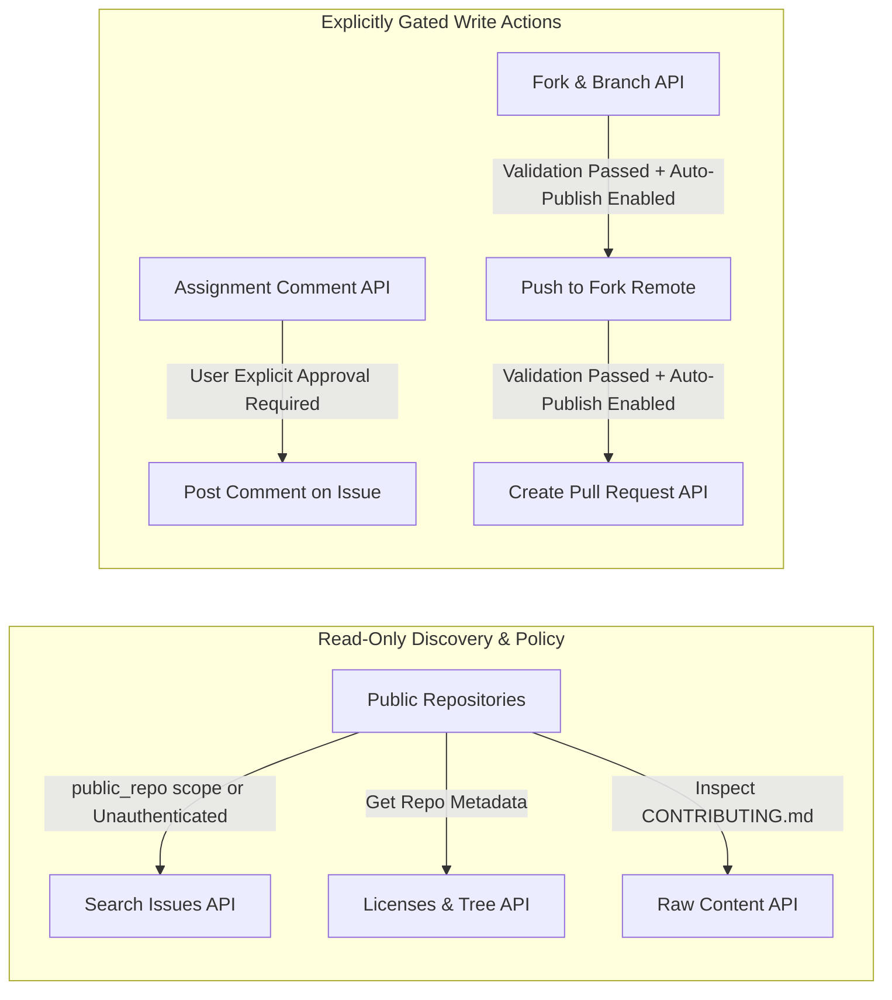

# Issue-to-PR Platform: GitHub Permission Model

## 1. Principle of Least Privilege

The platform strictly decouples read-only operations from write operations:

## 2. GitHub Token Scopes

| Scope | Purpose | When Required | Fallback / Behavior if Absent |
|---|---|---|---|
| *(No token)* | Global public issue discovery (Rate limit: 60 req/hr IP-based) | Unauthenticated mode | Allowed for read-only browsing with rate-limit warnings. |
| `public_repo` | Broad discovery (5,000 req/hr), fork creation, pull request publication to public repositories. | Full automated workflow | Platform warns that commenting and publishing are disabled. |
| `read:user`, `user:email` | Identify authenticated GitHub user to verify author identity and fork ownership. | User verification | User must enter GitHub username manually in settings. |
| `repo` (Optional) | Only required if contributing to private or internal organizational repos. | Optional enterprise use | Public repo workflow requires only `public_repo`. |

## 3. Fork vs. Direct Push Decision Logic
1. Check repository permissions via `GET /repos/{owner}/{repo}`:
   - If `permissions.push == true`: Repository permits direct branch creation. Push task branch directly to `upstream` remote.
   - If `permissions.push == false`: Fork-based contribution required:
     - Check if user already owns a fork of the repo via `GET /repos/{user}/{repo}`.
     - If not, create fork via `POST /repos/{owner}/{repo}/forks`.
     - Configure Git remote `origin` pointing to user's fork.
     - Push branch to `origin`.
     - Submit PR to `upstream:{default_branch}` from `user:{task_branch}`.
