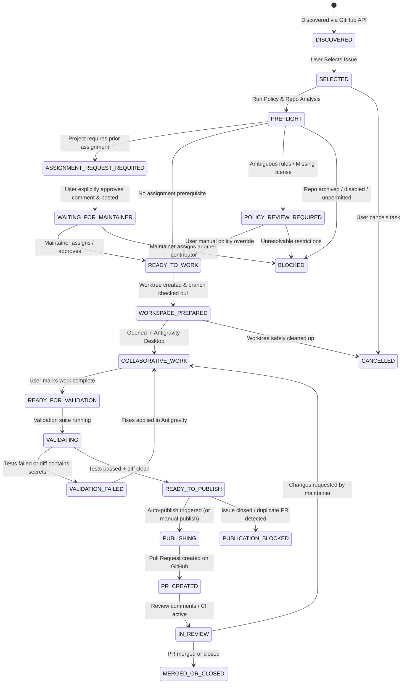

# Issue-to-PR Platform: Workflow State Transitions and Policy Gates

## 1. State Machine Definitions

## 2. Policy-Gate Matrix

| Stage Gate | Required Conditions to Advance | On Failure |
|---|---|---|
| **Preflight Gate** | Verified open issue; No existing assignees; Repo not archived; OSI-approved license detected; No duplicate open PRs. | Move to `POLICY_REVIEW_REQUIRED` with clear warning badge. |
| **Assignment Gate** | If repo specifies "comment before working", user MUST review draft comment and click "Approve & Post". API verifies assignment before branch creation. | Keep in `WAITING_FOR_MAINTAINER`. Never begin coding prematurely. |
| **Workspace Gate** | Bare clone or update succeeds; Isolated Git worktree directory created; Unique branch created matching repo convention. | Fail with disk/git error, rollback worktree. |
| **Validation Gate** | Diff security scan has ZERO secrets/unrelated files; All specified test commands return exit code 0; No test skipped disguised as passed. | Move to `VALIDATION_FAILED` with exact command output and exit codes. |
| **Publishing Gate** | `auto_publish_pr` setting enabled; Task state == `READY_TO_PUBLISH`; Remote branch pushed to fork or upstream; Target base branch verified; PR title & body include issue reference (`Fixes #...`). | Move to `PUBLICATION_BLOCKED` with detailed explanation. |
